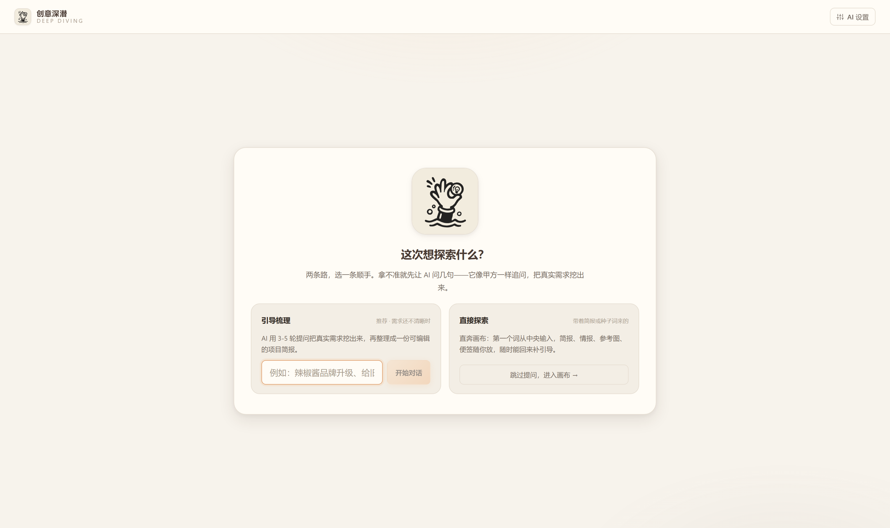
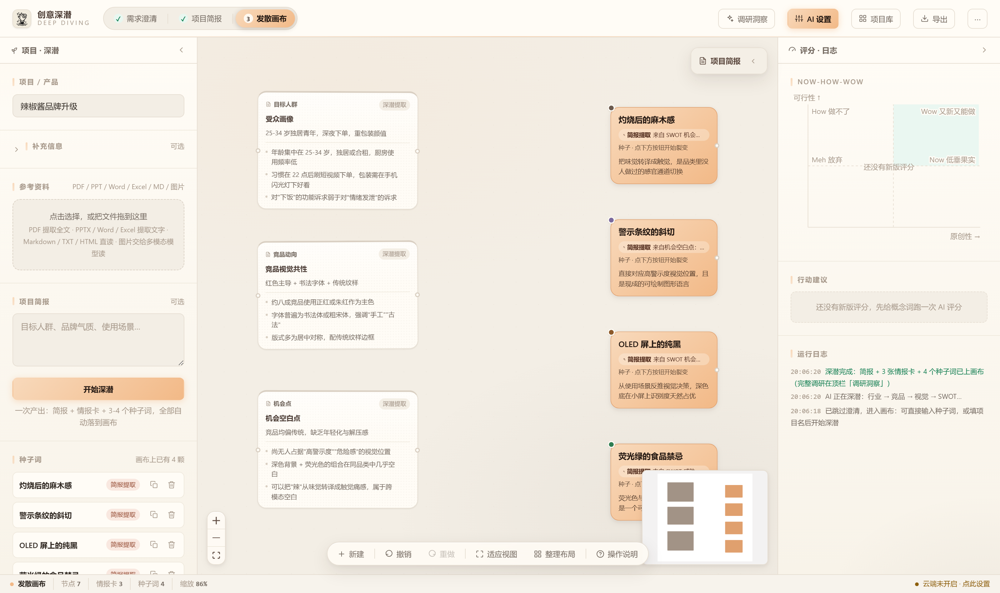

# 创意深潜 Deep Diving

[](LICENSE)

> 在思维的海洋中下潜，打捞灵感珍珠。

AI 驱动的视觉设计师认知工作台。无限画布 + 真实 LLM 接口，覆盖「调研 → 发散 → 收敛 → 转译」全链路。





## 它做什么

不替你做设计，只做三件事：

1. **问清** —— 用对话把真实需求挖到底，而不是让你填表
2. **发散** —— 从一个词裂变出六个维度的联想，逼你想到没想到的方向
3. **收回** —— 用可解释的评分帮你判断哪条方向值得推进

你的判断始终是最终决定。AI 只负责穷举和解释。

六维评分模型怎么来的、反平庸机制为什么这么设计、以及为什么评分不用 Embedding——这些推导写在对应源码的注释里（`src/lib/scoring.ts`、`src/lib/prompts.ts`），改之前值得先读。

## 下载安装（普通用户看这里）

去 [Releases](https://github.com/injayxu-dotcom/deep-diving/releases) 下载，**不需要装 Node、不需要命令行**：

| 文件 | 适用 | 说明 |
| :--- | :--- | :--- |
| `DeepDiving-Setup-x.y.z.exe` | Windows | 安装版。双击安装，可以选安装目录，自动建桌面与开始菜单快捷方式 |
| `DeepDiving-Portable-x.y.z.exe` | Windows | 免安装版。单个 exe，双击即用，不写注册表、不需要管理员权限 |

装完是一个独立窗口，不是浏览器标签页。数据存在本机，卸载时默认保留（重装后项目还在）。

首次打开会引导你填一个 AI Key——点右上角 **AI 设置**，选服务商（DeepSeek / 通义 / Kimi / 智谱 / 本地 Ollama）粘贴 Key 即可，其余字段已预置。

## 从源码运行（开发者看这里）

### 桌面应用

```bash
npm install
npm run desktop        # 构建后直接开窗口
npm run desktop:dev    # 改代码热更新（同时起 Vite 和窗口）
```

### 网页版

```bash
npm install
npm run dev
```

打开 http://127.0.0.1:5173 。界面可以直接浏览；要跑「深潜」需要一个 **OpenAI 兼容**的 API Key，点右上角 **AI 设置** 填入即可。

### 配置 AI 接口

默认 DeepSeek，但只要是 **OpenAI 兼容协议** 都能用（通义 / Kimi / 智谱 / OpenAI / 本地 Ollama 等）：

| 字段 | 示例 |
| :--- | :--- |
| Base URL | `https://api.deepseek.com` |
| API Key | `sk-...` |
| 模型 | `deepseek-chat` |
| 温度 | 0.9（创意发散建议偏高） |

填完点 **测试连接** 验证。Key 存在本机 localStorage，只发给本地代理。

不想把 Key 存浏览器的话，启动前设环境变量，界面留空即可：

```bash
set DEEPSEEK_API_KEY=sk-xxx
npm run dev
```

## 为什么有本地代理

浏览器直连 LLM 厂商会被 CORS 拦，而且 Key 暴露在前端不安全。所以 Vite dev server 上挂了一个 `/api/ai/chat` 中间件（`server/viteAiProxy.ts`）转发请求，并把 SSE 流原样透传给前端。

> 安全：baseUrl 由客户端传入，天然是 SSRF 入口——浏览器不阻止第三方站点向 localhost 发请求，恶意网页可借此探测本机与内网服务。因此中间件默认做三重收敛：协议 → 内网/回环地址 → 服务商域名白名单。
> 接列表外的服务商：`DD_ALLOWED_HOSTS=your.host.com npm run dev`
> 接本地 Ollama / LM Studio：`DD_ALLOW_LOCALHOST=1 npm run dev`

生产构建（`npm run build`）只产出静态文件，不含这个代理。要上线的话需要自己补一个后端。

## 桌面端是怎么做的

Electron 外壳 + 同一套前端产物。三处和网页版不同：

1. **AI 转发搬到了主进程**。打包后没有 Vite dev server，前端会退化成浏览器直连（被厂商 CORS 拦）。现在主进程在 `127.0.0.1` 的随机端口起一个转发服务，和 dev 用的是**同一份实现**（`server/aiProxyCore.ts`），服务商白名单与 SSRF 收敛一行没改——两处各写一遍的话，这类规则迟早漂移，而且漂移不会报错。
2. **转发口带随机令牌**。本机的任何进程都能连 `127.0.0.1` 的任意端口，不加令牌就等于开了一个公开的免费 AI 网关，还能被当成探测内网的跳板。令牌只存在于 preload 注入的地址里。
3. **数据目录按模式分开**。`desktop:dev` 用独立目录，调试时随手建的项目、改的 Key 不会写进正式数据。

### 自己打包

```bash
npm run desktop:dist    # Windows 安装版 + 免安装版，落在 release/
npm run desktop:dir     # 只出解包目录，调试用
npm run icon            # 改了 DD logo.svg 后重新生成 build/icon.png
```

产物约 72MB，其中 `app.asar` 只有 2.5MB —— react / pdfjs / jszip 已经由 Vite 打进 `dist`，运行时里不重复放一份，语言包也只留中英两份。

> 打包卡在 `winCodeSign` 解压失败（报"无法创建符号链接"）时：Windows 普通账户没有建符号链接的权限。开一次**开发者模式**（设置 → 系统 → 开发者选项），或改用 GitHub Actions 打包（CI 自带权限）。本地应急可以对单次命令加 `-c.win.signAndEditExecutable=false`，代价是 exe 用默认图标。

## 操作方式

| 操作 | 效果 |
| :--- | :--- |
| 左栏填产品名（+ 可选补充方向 / 参考资料）→ **开始深潜** | 一次产出：深潜简报 + 3 张情报卡钉上画布 + 3-4 个种子词自动生成在画布上 |
| 点顶栏 **深潜简报** | 打开抽屉：行业现状 / 竞品详情（特点·受众）/ 视觉元素（颜色·色调·字体）/ SWOT |
| 点顶栏 **交付文档** | 把深潜简报 / 情报卡 / 种子词（含来源）/ 收敛概念与提示词汇编成 Markdown：预览 → 复制全文 / 下载 .md |
| **上传参考资料** | 左栏拖入 PDF（提取全文）/ PPTX（提取文字）/ 图片（交给多模态模型），随深潜一起送给 AI |
| 拖动词条到画布 | 该词条成为一颗种子 |
| **拖图片文件进画布** | 建参考图节点，**自动提取色卡**（本地 canvas 计算，不花 token） |
| **双击节点** | 打开六维裂变轮盘，选维度后 AI 生成 6-8 个联想词 |
| 选中节点 | 节点内浮出操作条：继续裂变 / 创意简报 / 评分 / 提示词 / 挂图 / 收敛 |
| 图节点 → AI 读图 | 多模态模型提取配色、字体气质、版式规律、材质工艺、情绪基调 |
| 拖节点圆点连线 | AI 判定共性（黄）/ 对立（红）/ 递进（蓝） |
| 点色块 | 复制色值 |
| 滚轮 / 拖空白 | 缩放 / 平移；迷路了点「适应视图」 |
| Esc | 关闭轮盘 |

### 关于种子词（深潜自动提取）

种子词**必须来自生成的简报**，不能是用户输入的复述：每个种子词挂了来源标签（如「来自 SWOT 机会项：深夜手机下单场景」），悬停可看「为什么选它」。左栏的「补充方向」（情绪氛围等）只是**筛选镜头**——AI 优先挑与它共振的简报内容，但宁可挑不到，也不会为了迎合而编造简报里没有的东西。

### 关于清空

「清空」会清除画布节点、连线、情报卡、参考资料、简报和补充方向，**保留项目名与 AI 设置**（免得重填 Key）。确认走的是应用内弹窗——`window.confirm` 在沙箱 iframe 里会被静默拦截，表现为「点了没反应」。

### 关于 AI 读图

`deepseek-chat` 是纯文本模型，**不支持视觉输入**。要用「AI 读图」需在设置里换成支持图片的模型，例如：

- 通义 `qwen-vl-max`
- 智谱 `glm-4v-plus`
- OpenAI `gpt-4o`

模型不支持时会给出明确提示，而不是干巴巴报错。

单节点最多挂 6 张图，上传时自动压缩到 1000px 宽 / JPEG 0.75。base64 存在 localStorage，配额约 5MB，满了会在日志区提示你删图或导出备份。

## 目录结构

```
src/
├── types.ts                  类型与六大维度定义（含 DeepDiveReport / ReferenceFile）
├── lib/
│   ├── ai.ts                 LLM 客户端（SSE 流式 + 多模态 + JSON 容错提取）
│   ├── color.ts              本地色卡提取与图片压缩（纯 canvas，不调 AI）
│   ├── docExport.ts          交付文档组装（状态 → Markdown，不调 AI）
│   ├── files.ts              参考资料解析：PDF 全文 / PPTX 文字 / 图片压缩
│   ├── prompts.ts            提示词（深潜简报 + 反平庸约束 + 裂变 / 读图 / 评分）
│   └── storage.ts            localStorage 持久化与导出
├── store/useStore.ts         zustand：画布状态 + 全部 AI 动作 + 径向布局
├── components/
│   ├── nodes.tsx             种子 / 裂变词 / 概念 / 情报卡 / 参考图节点
│   ├── DimensionWheel.tsx    六维裂变轮盘（ViewportPortal）
│   ├── LeftPanel.tsx         项目输入 + 补充方向 + 参考资料上传 + 情报卡片墙
│   ├── RightPanel.tsx        简报 / 提示词 / 评分气泡图 / 日志
│   ├── ReportDrawer.tsx      深潜简报抽屉（行业 / 竞品 / 视觉 / SWOT）
│   ├── DocModal.tsx          交付文档预览（复制 / 下载 .md）
│   ├── ConfirmDialog.tsx     应用内确认弹窗（替代被 iframe 拦截的 confirm）
│   └── SettingsModal.tsx     AI 接口配置与连接测试
└── App.tsx                   无限画布装配
server/
├── aiProxyCore.ts            AI 转发核心：白名单、SSRF 收敛、SSE 透传（dev 与桌面端共用）
└── viteAiProxy.ts            把 core 挂到 Vite dev server 上
electron/
├── main.ts                   主进程：原生窗口 + 本地转发服务 + 单实例锁
├── preload.ts                只往页面注入一个地址和一个版本号（contextIsolation 开着）
├── build.mjs                 用 esbuild 打主进程（产物 .cjs，因为包是 type: module）
├── dev.mjs                   一条命令同时起 Vite 与窗口
├── prepare-electron.mjs      复制精简运行时（筛掉用不上的语言包）
└── make-icon.cjs             用 Electron 渲染 DD logo.svg → build/icon.png
tools/                        mock AI 服务、端到端测试、截图脚本
docs/                         部署维护说明、界面截图
build/icon.png                应用图标（源文件是 DD logo.svg）
```

## 与最初设计的偏差（都是刻意的）

1. **画布用 React Flow，不是 Konva/Fabric**。最初选的 Konva 是通用 2D 绘图库，节点图要自己实现拖拽、连线、命中检测。React Flow 是专做节点图的成熟方案，省下的工作量用在 AI 链路和提示词上更有价值。

2. **模块一的可信数据源引擎改为 LLM 直接产出**。原方案依赖 The Economist API / 蝉妈妈 OAuth / CNKI，独立设计师拿不到授权，`site:` 爬取兜底有合规风险。改为让 LLM 基于自有知识输出判断，并**强制标注每条的置信度**，不编造精确数字。

3. **模块三的评分用 LLM 判断而非 Embedding 余弦相似度**。见下方说明。

4. **评分可被人工覆盖**。LLM 给出分数和依据，但最终判断权在设计师。

### 关于「反平庸机制」

最初的设计里没有这一层，而它是产品的生死线：LLM 联想天生趋中，默认输出一定是「辣椒 → 热情 → 火焰 → 红色」这类正确的废话，那产品就只是个慢一点的脑图工具。

`src/lib/prompts.ts` 里的 `ANTI_MEDIOCRE` 系统提示词做了四件事：
- 列出 60+ 个套路词黑名单（热情 / 简约 / 国潮 / 高级感 / 氛围感…），输出即失败
- 强制输出可感知的具象物象，要求「能被画出来」
- 禁止同批近义词重复
- 明确要求「宁可偏僻、怪异、有风险，也不要安全、正确、平庸」

### 关于评分为什么不用 Embedding

最初方案是 `text-embedding-3-small` 算语义相似度 / 反差值，示例里出现了「匹配度 9.0、与 Z 世代匹配 0.92、与解压气质匹配 0.88」。

问题在于这些数字没有来源：embedding 算「灼烧感」和「Z 世代追求感官刺激」的余弦相似度，实际可能只有 0.3 出头，要凑成 0-10 分需要做一次线性映射，而映射系数是拍脑袋定的。**用精确数字包装一个猜测，比直接给猜测更危险**——分数一旦精确，设计师就会信任排序。

现在改为 LLM 输出分数 + 3 条引用简报具体信息的依据 + 一句话建议，气泡图坐标仍可人工覆盖。至少能说清「为什么」。

## 测试

```bash
# 终端 1：mock LLM（无需真实 Key）
node tools/mock-ai.mjs          # 127.0.0.1:8788

# 终端 2：dev server
npm run dev

# 终端 3：端到端测试（20 组，含深潜流程 / 资料上传 / P2 闭环 / P4 评分讨论 / P5 撤销与快照 / P6 节点对象语言与便签 / 交付文档 / 清空按钮回归）
node tools/e2e.mjs
```

改了 `mock-ai.mjs` 之后必须重启它，否则跑的还是旧逻辑。

`tools/mock-ai.mjs` 按请求内容里的标记词返回对应的 OpenAI 兼容 SSE 流，可以在不花一分钱、不联网的情况下验证从情报采集到提示词生成的完整链路。

`npx tsc --noEmit` 类型检查零错误，`npx vite build` 构建干净：主包 551KB（gzip 200KB），pdfjs / jszip 按需懒加载单独分包。`node tools/shots.mjs` 可产出 6 张 UI 截图。

## 部署与维护

云端同步、云函数部署、子路径部署、域名与令牌配置等运维内容，已移到独立文档：

→ [`docs/MAINTAINING.md`](docs/MAINTAINING.md)

**只想本地跑起来的话不需要看那份文档** —— 上面「快速开始」已经够了。

## 安全须知

两条 AI 通路都接受「调用方指定的上游地址」，天然是 SSRF 入口，所以默认都做了收敛。部署前请确认：

**本地 dev 代理**（`server/viteAiProxy.ts`）

- 默认拒绝内网 / 回环地址，只放行内置的服务商域名白名单
- 接列表外的服务商：`DD_ALLOWED_HOSTS=your.host.com npm run dev`
- 接本地模型（Ollama / LM Studio）：`DD_ALLOW_LOCALHOST=1 npm run dev`

**云端云函数**（`cloud/functions/api/index.js`）

| 环境变量 | 作用 |
| :--- | :--- |
| `WS_TOKEN` | 工作区读写令牌。**公网部署务必设置**，否则数据对所有人可读写 |
| `LLM_REQUIRE_TOKEN=1` | 让 `/ai/chat` 也校验令牌。不设的话它完全无鉴权，会被当免费 AI 网关刷，账单算你头上 |
| `LLM_ALLOWED_HOSTS` | 追加允许的上游域名（英文逗号分隔），默认已覆盖常见厂商 |
| `LLM_LOCK_KEY=1` | 忽略前端传来的 Key，只用服务端 `LLM_API_KEY`，Key 永不上行 |
| `LLM_ALLOW_ANY_HOST=1` | 关闭白名单校验，仅调试用。**公网绝对不要开** |

**API Key 存放**

浏览器直连 LLM 时，Key 会出现在请求头里并存进本机 localStorage。介意的话：把 Key 填进云函数的 `LLM_API_KEY` 环境变量、前端留空，并设 `LLM_LOCK_KEY=1` 强制走服务端代理，Key 完全不落浏览器。

**云环境地址**

`DEFAULT_API_BASE` 读 `VITE_API_BASE` 环境变量，源码里不含环境 ID。本地配置写在 `.env.local`（已被 git 排除），不要提交。

## 已知限制

- 未开启云端同步时，数据只在本机 localStorage（约 5MB），换浏览器会丢，用「导出」按钮备份
- 单节点最多 6 张图，图片多了会撑爆配额
- 暂无多人协作、历史回溯（规划里排在 V1.5 / V2.5）
- 情报卡片依赖 LLM 的既有知识，不做实时联网检索
- 节点还不能做 moodboard 拼接（多图合成一张情绪板）
- 云端同步是「单人单工作区」模型，未做登录与版本历史；`/ws` 默认无令牌保护，公网使用建议配 `WS_TOKEN`
- 浏览器直连 LLM 时 API Key 会出现在请求头里；介意的话把 Key 放进云函数 `LLM_API_KEY` 环境变量、前端留空，强制走代理路径
